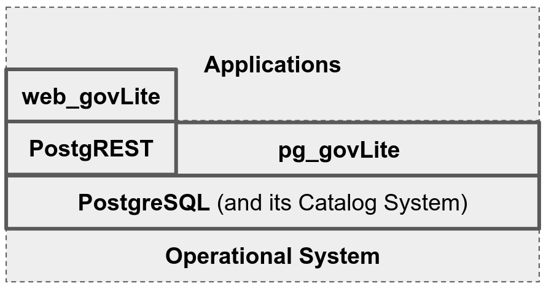
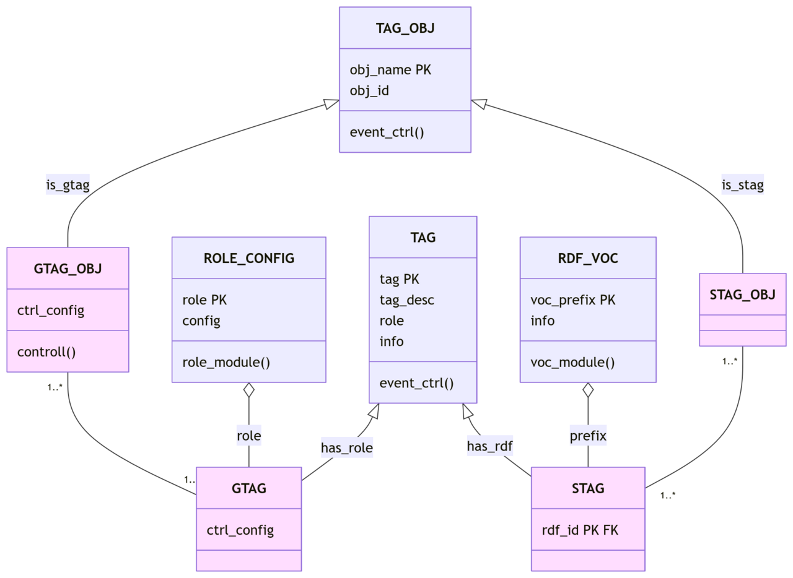

**pg_govLite** is designed to perform basic data governance tasks in metadata management, complementing [System Catalogs](https://www.postgresql.org/docs/current/catalogs.html) and acting as a unified metadata store. It manages the Medallion architecture and *tags* for all data objects (columns, tables, schemas, functions, etc.), with [RDF](https://en.wikipedia.org/wiki/Resource_Description_Framework) semantic tags, and [governed tags](https://docs.databricks.com/aws/en/admin/governed-tags/).



## Objectives
Adopt [Convention over Configuration](https://en.wikipedia.org/wiki/Convention_over_configuration) (CoC) principle for the basic metadata definition and maintenance tasks:

* Semantic tags and control tags;
* Medallion control of data objects (datasets and its part-whole hierarchy), like input/output and intermediary datasets;
* Data tier controls the identity-service and activation of data-quality services. See also "relevance driver" (business, regulatory, analytics, or operational)
* To generate human-readable structures System Catalog as standard structured content, for documentation.

All modules are external implementations, for example data quality is DQX, Secure control is external ABAC, etc. The pg_govLite is a central orchestration of modules by tags and triggers.

## Documentation
See and, please, contribute commenting or correcting:
* USER GUIDE - https://docs.google.com/document/d/1G7tC9tuRwqmwxtxUhElkZtnoM5JYWC_f2s2pLXkhXKs/
* TUTORIAL - ...

Below a fast presentation. UML class:



Documentation helper scripts are also included in `src`:

* `src/doc01-UDF-mediawiki.sql` generates MediaWiki documentation for PostgreSQL UDFs, including summary rows, page sections, full pages, and XML dumps. Usage examples are available in `src/doc01-UDF-mediawiki.md`.
* `src/inst04-documentation_examples.sql` installs executable documentation examples as views in `gvlt_doc_examples`, exposes function-example dependencies, and supports secondary example marking. Usage examples are available in `src/inst04-documentation_examples.md`.

### Use cases and test cases

Curated tutorial-derived use cases are documented in `assets/usecases`.

* `assets/usecases/README.md` defines the use-case/test-case pattern.
* `assets/usecases/SpCs01-public-health.md` documents the executable simple tutorial case.
* `assets/usecases/CxCs01-municipal-climate.md` documents the complex municipal climate case and its external dependencies.

Use cases should use the short governance API:

* `gvlt.tag_include(...)` creates or updates governed tags.
* `gvlt.tagobj_include(...)` associates governed tags with schemas, relations, and columns.
* `gvlt.tag_disable(...)` and `gvlt.tagobj_disable(...)` deactivate tags and object/tag associations without deleting catalog history.
* `gvlt.obj_tags(...)`, `gvlt.obj_has_tags(...)`, and `gvlt.usecase_assert_obj_tags(...)` support inspection and executable checks.
* `gvlt.tag_get(...)`, `gvlt.tag_search(...)`, `gvlt.relation_columns(...)`, `gvlt.medallion_objects(...)`, and `gvlt.governance_check(...)` provide catalog discovery and audit helpers.

The lower-level `gvlt.govtags_*` functions remain the internal implementation surface and are still covered by core asserts.

### User manual and executable tutorial

The user manual is available as a Word document:

* `manual/pg_govLite_User_Manual_and_Practical_Governance_Tutorial.docx`

The manual explains the project resources and includes a practical governance tutorial using a public-data scenario inspired by IBGE municipality data and ANS supplementary-health data.

The executable SQL version of the tutorial is:

* `assets/data/manual01-public_health_tutorial.sql`

It creates a deterministic local sample, so it does not download external data. The script creates the tutorial schemas and tables, applies governed tags, publishes a Gold view, registers an executable documentation example, and runs final checks with `RAISE EXCEPTION` if an expected result is missing.

## Install the PostgreSQL extension

Use the native extension for new installations that should support future upgrades. Choose one layout per database.

| Layout | Where the objects live | Extension name |
| --- | --- | --- |
| `multi` (default) | The framework uses multiple schemas, including `gvlt` and `lib`. | `pg_govlite` |
| `single` | The framework uses one existing schema you choose, with prefixed object names. | `pg_govlite_single` |

You need PostgreSQL 15 or later, Python 3.9 or later, GNU Make, and the PostgreSQL client tools. Install the package with an OS account that can write to the server's PostgreSQL extension directory. Activate it in the database with a PostgreSQL superuser, as both layouts use event triggers.

Version 0.3.0 adds YAML/JSON conversion, YAML file loading, and Mustache rendering in both layouts. Install PL/Python (`plpython3u`) for the server's PostgreSQL major version, plus PyYAML and Chevron in the Python environment used by PL/Python. Native activation uses `CASCADE` to create the PL/Python extension when absent; its server package and Python dependencies must already be installed. See [dependency and function details](docs/INSTALLATION.md#yamlmustache-and-cascading-dependencies-030).

### 1. Install the files on the PostgreSQL server

Run these shell commands where the PostgreSQL server is installed. This example uses the `0.3.0` release tag once published.

```sh
git clone --branch 0.3.0 https://github.com/AddressForAll/pg_govLite.git
cd pg_govLite
pg_config --version
pg_config --sharedir
make install
```

`make install` copies both layouts into the server's extension directory. If there are multiple PostgreSQL installations, pass the path to the matching tool, for example `make install PG_CONFIG=/usr/lib/postgresql/16/bin/pg_config`. For Docker, the files must be available **inside the container running PostgreSQL**, in its own `$(pg_config --sharedir)/extension` directory. Install them as part of the image or stage the package with `DESTDIR` and copy its contents into the container. A copy made only inside a running container is lost when that container is replaced.

### 2. Connect to the target database

Run the remaining shell commands from the checkout for the same release. The target database must already exist. Set `DB_URL` to your PostgreSQL connection string, then verify the connection before creating the extension.

```sh
DB_URL='postgresql://postgres@localhost:5432/my_database'
psql -X --dbname "$DB_URL" -c '\conninfo'
```

Use your usual authentication, such as `.pgpass`. With SSH forwarding, use the **local forwarded port** and confirm it points to the intended PostgreSQL instance on the remote host. If `psql` already connects using your session defaults, you can instead use `DB_URL=my_database` to select the database while keeping those defaults. Pass that same value to both `psql` and `make`.

### 3. Activate one layout

For **multiple schemas**, run:

```sh
make core DBURL="$DB_URL" LAYOUT=multi
```

For **one schema**, choose an existing schema such as `cliente`. If you are using a new test database and need to create the schema first, run `psql -X --dbname "$DB_URL" -v ON_ERROR_STOP=1 -c 'CREATE SCHEMA cliente;'`.

```sh
make core DBURL="$DB_URL" LAYOUT=single AUTHORIZED_SCHEMA=cliente
```

Restrictive governance is disabled by default. To enable it at installation, add `RESTRICTIVE=SIM MASTER_ROLE=carga_master` to the selected command. The master role must already exist and meet the [role requirements](docs/INSTALLATION.md#requirements).

Once the server files are installed, you can also activate the extension directly with SQL as a superuser. Choose one command.

```sql
-- Multi layout
CREATE EXTENSION pg_govlite VERSION '0.3.0' CASCADE;

-- Single layout
CREATE EXTENSION pg_govlite_single WITH SCHEMA cliente VERSION '0.3.0' CASCADE;
```

### 4. Verify the installation

```sh
psql -X --dbname "$DB_URL" -c '\dx pg_govlite*'
```

Check that the output shows the expected extension and version. For `single`, it should also show the chosen schema. If PostgreSQL reports that the extension is unavailable, confirm that the files were installed in the PostgreSQL server or container reached by `DB_URL`.

As the same DBA, run the checks for your selected layout. Each function should return zero rows when it finds no issues.

```sql
-- Multi layout
SELECT * FROM gvlt.governance_check();
SELECT * FROM gvlt.policy_check();

-- Single layout (replace cliente with your schema)
SELECT * FROM cliente.gvlt_governance_check();
SELECT * FROM cliente.gvlt_policy_check();
```

### Upgrade an existing native installation

Check out the target release, run `make install` on the PostgreSQL server again, then run the command for the layout already installed in each database.

```sh
make upgrade DBURL="$DB_URL" LAYOUT=multi
# Or:
make upgrade DBURL="$DB_URL" LAYOUT=single
```

The target release must include a migration path from the installed version. The single layout reuses its registered schema. Verify the version again with `\dx pg_govlite*`. Version `0.2.0` is the first native release. Databases set up with the standalone installer require a separate adoption migration before they can use native upgrades. See the [release procedure and backup limitations](docs/INSTALLATION.md#native-extension-releases).

### Standalone setup and testing

The standalone installer remains available through `python3 setup.py`. See the [standalone setup instructions](docs/INSTALLATION.md#install).

- `make help` lists available targets.
- `make render` generates reviewable standalone SQL without connecting.
- `make manualExamples DBURL="$DB_URL"` runs the multi-layout tutorial. Add `LAYOUT=single AUTHORIZED_SCHEMA=cliente` for the single-layout tutorial. `make usecaseExamples` is an alias.
- `make test` runs offline tests. Run `make test-db` against a disposable PostgreSQL instance. The suite manages its own uniquely named databases and roles. See the [native extension test setup](docs/INSTALLATION.md#examples-and-verification).
