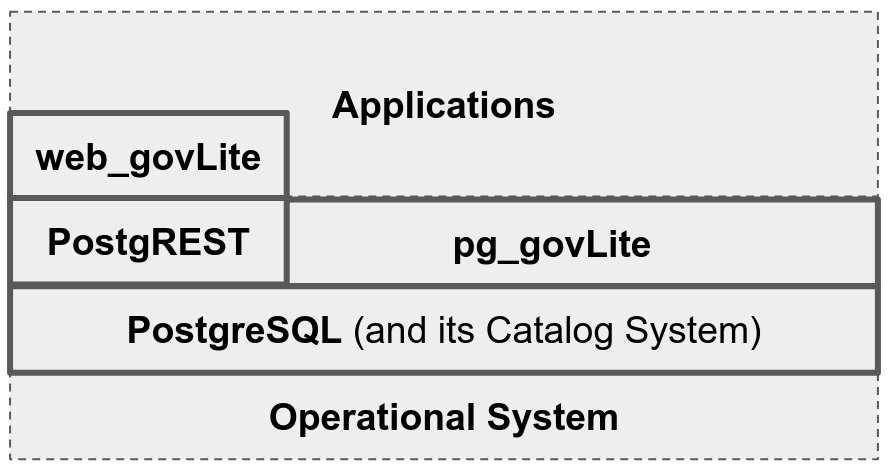
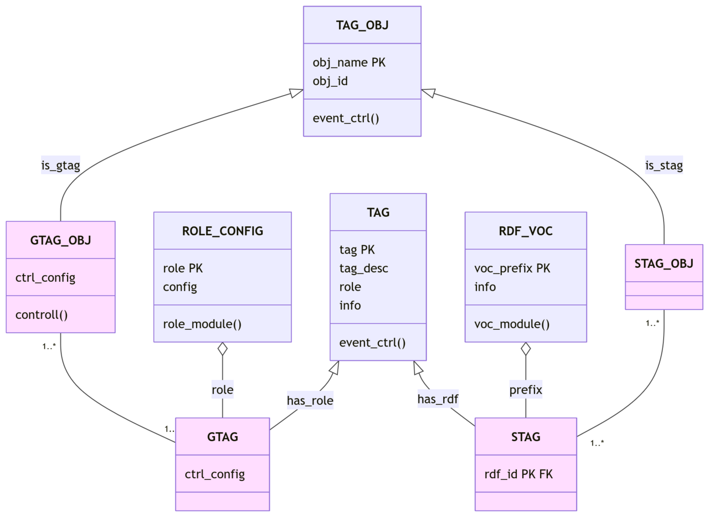

**pg_govLite** is designed to perform basic data governance tasks in metadata management, complementing [System Catalogs](https://www.postgresql.org/docs/current/catalogs.html) and acting as a unified metadata store. It manages the Medallion architecture and *tags* for all data objects (columns, tables, schemas, functions, etc.), with [RDF](https://en.wikipedia.org/wiki/Resource_Description_Framework) semantic tags, and [governed tags](https://docs.databricks.com/aws/en/admin/governed-tags/).



## Objectives
Adopt [Convention over Configuration](https://en.wikipedia.org/wiki/Convention_over_configuration) (CoC) principle for the basic metadata definition and maintenance tasks:

* Semantic tags and control tags;
* Medallion control of data objects (datasets and its part-whole hierarchy), like input/output and intermediary datasets;
* Data tier controls the identity-service and activation of data-quality services. See also "relevance driver" (business, regulatory, analytics, or operational)
* To generate human-readable structures System Catalog as standard structured content, for documentation.

All modules are external implementations, for example data quality is DQX, Secure control is external ABAC, etc. The pg_govLite is a central orchestration of modules by tags and triggers.

## Documentation
See and, please, contribute commenting or correcting:
* USER GUIDE - https://docs.google.com/document/d/1G7tC9tuRwqmwxtxUhElkZtnoM5JYWC_f2s2pLXkhXKs/
* TUTORIAL - ...

Below a fast presentation. UML class:



Documentation helper scripts are also included in `src`:

* `src/doc01-UDF-mediawiki.sql` generates MediaWiki documentation for PostgreSQL UDFs, including summary rows, page sections, full pages, and XML dumps. Usage examples are available in `src/doc01-UDF-mediawiki.md`.
* `src/inst04-documentation_examples.sql` installs executable documentation examples as views in `gvlt_doc_examples`, exposes function-example dependencies, and supports secondary example marking. Usage examples are available in `src/inst04-documentation_examples.md`.

### Use cases and test cases

Curated tutorial-derived use cases are documented in `assets/usecases`.

* `assets/usecases/README.md` defines the use-case/test-case pattern.
* `assets/usecases/SpCs01-public-health.md` documents the executable simple tutorial case.
* `assets/usecases/CxCs01-municipal-climate.md` documents the complex municipal climate case and its external dependencies.

Use cases should use the short governance API:

* `gvlt.tag_include(...)` creates or updates governed tags.
* `gvlt.tagobj_include(...)` associates governed tags with schemas, relations, and columns.
* `gvlt.tag_disable(...)` and `gvlt.tagobj_disable(...)` deactivate tags and object/tag associations without deleting catalog history.
* `gvlt.obj_tags(...)`, `gvlt.obj_has_tags(...)`, and `gvlt.usecase_assert_obj_tags(...)` support inspection and executable checks.
* `gvlt.tag_get(...)`, `gvlt.tag_search(...)`, `gvlt.relation_columns(...)`, `gvlt.medallion_objects(...)`, and `gvlt.governance_check(...)` provide catalog discovery and audit helpers.

The lower-level `gvlt.govtags_*` functions remain the internal implementation surface and are still covered by core asserts.

### User manual and executable tutorial

The user manual is available as a Word document:

* `manual/pg_govLite_User_Manual_and_Practical_Governance_Tutorial.docx`

The manual explains the project resources and includes a practical governance tutorial using a public-data scenario inspired by IBGE municipality data and ANS supplementary-health data.

The executable SQL version of the tutorial is:

* `assets/data/manual01-public_health_tutorial.sql`

It creates a deterministic local sample, so it does not download external data. The script creates the tutorial schemas and tables, applies governed tags, publishes a Gold view, registers an executable documentation example, and runs final checks with `RAISE EXCEPTION` if an expected result is missing.

## Install or test

New installations support **multiple schemas** (default) or a **single authorized schema**, with optional restrictive governance for Silver and Gold. See [installation, permissions and policy operations](docs/INSTALLATION.md).

```sh
python setup.py
# Automation; connection supplied through PGHOST/PGPORT/PGUSER/PGDATABASE:
python setup.py --non-interactive --mode single --schema cliente --restrictive SIM --master carga_master
```

Setup requires Python 3.9+, psql, PostgreSQL 15+ and DBA privileges for event triggers. It installs in one transaction, preserves unrelated objects and refuses framework collisions/reinstallation. The installation SQL files are templates rendered by setup; do not run them directly through psql.

* `make` shows options; `make core` and `make all` install a fresh core and run basic assertions.
* `make core LAYOUT=single AUTHORIZED_SCHEMA=cliente RESTRICTIVE=SIM MASTER_ROLE=carga_master` selects the single layout.
* `make render` generates reviewable SQL without connecting.
* `make manualExamples` runs the multi-schema manual tutorial; add `LAYOUT=single AUTHORIZED_SCHEMA=cliente` for the single-schema tutorial.
* `make usecaseExamples` aliases the selected tutorial.
* `make test` runs offline installer checks; `make test-db` runs the integration matrix against a disposable PostgreSQL instance. The suite creates and removes only its uniquely named databases and roles.
* `make dropDbTest` and `make assertDiff` are compatibility aliases for `make test-db`; they no longer drop a preexisting fixed test database or compare version-specific demonstration output.

Existing databases are not migrated. pgAdmin/PostgREST adjustments are deferred to a separate delivery.
